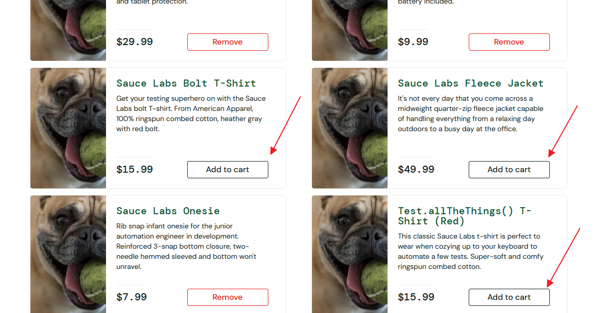

# BUG-02
## Summary:
Not every product can be added to the cart.
## Related Test Case:
TC-25
## Environment:
Win 10 Pro 19045.6466 + Chrome 152.0.7977.83 (Official Build) (64-bitowa)
## Preconditions:
User is logged in as problem_user.
## Test Data:
- Username: problem_user
- Password: secret_sauce
## Steps to Reproduce:
1. Open https://www.saucedemo.com/ 
2. Enter the correct username and password 
3. Click the "Login" button
4. On the products page, click the "Add to cart" button for all products.
## Actual Result:
Three out of six products cannot be added to the cart.
## Expected Result:
All products should be successfully added to the cart.
## Priority: 
High
## Attachments:

