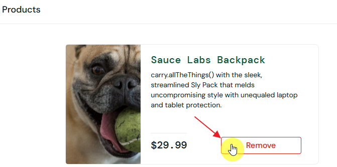

# BUG-03
## Summary:
Product cannot be removed from the cart on the products page.
## Related Test Case:
TC-26
## Environment:
Win 10 Pro 19045.6466 + Chrome 152.0.7977.83 (Official Build) (64-bitowa)
## Preconditions:
The user is logged in as problem_user and has added a product to the cart from the products page.
## Test Data:
- Username: problem_user
- Password: secret_sauce
## Steps to Reproduce:
1. Open https://www.saucedemo.com/ 
2. Enter the correct username and password 
3. Click the "Login" button
4. On the product page, click the "Add to cart" button.
5. On the product page, click the "Remove" button.
## Actual Result:
The product is not removed from the cart after clicking the "Remove" button on the product page.
## Expected Result:
The product should be successfully removed from the cart after clicking the "Remove" button on the product page.
## Priority: 
High
## Attachments:

