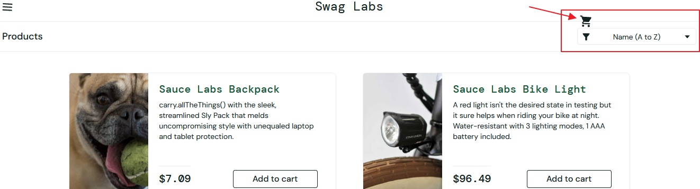

# BUG-07
## Summary:
The cart icon is incorrectly positioned.
## Related Test Case:
TC-32
## Environment:
Win 10 Pro 19045.6466 + Chrome 152.0.7977.83 (Official Build) (64-bitowa)
## Preconditions:
The user is logged in as visual_user.
## Test Data:
- Username: visual_user
- Password: secret_sauce
## Steps to Reproduce:
1. Open https://www.saucedemo.com/ 
2. Enter the correct username and password 
3. Click the "Login" buton
## Actual Result:
The cart icon is not displayed correctly and almost overlaps the sorting menu.
## Expected Result:
The cart icon should be displayed in the upper-right corner of the site.
## Priority: 
Low
## Attachments:

