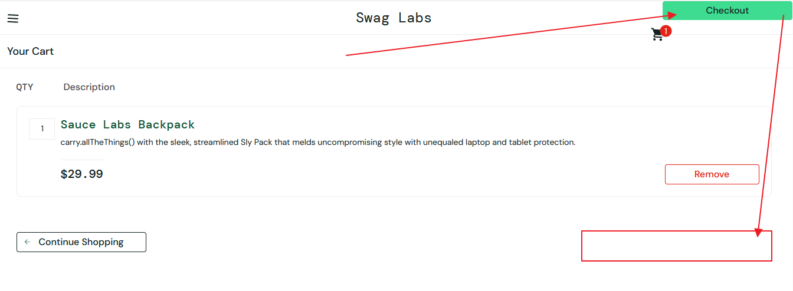

# BUG-08
## Summary:
The "Checkout" button is incorrectly positioned.
## Related Test Case:
TC-33
## Environment:
Win 10 Pro 19045.6466 + Chrome 152.0.7977.83 (Official Build) (64-bitowa)
## Preconditions:
The user is logged in as visual_user.
## Test Data:
- Username: visual_user
- Password: secret_sauce
## Steps to Reproduce:
1. Open https://www.saucedemo.com/ 
2. Enter the correct username and password 
3. Click the "Login" button
4. On the product page, click the "Add to cart" button
5. Click on the cart icon
## Actual Result:
The "Checkout" button is displayed in the upper-right corner of the site.
## Expected Result:
The "Checkout" button should be correctly displayed in the lower-right corner of the site, opposite the "Continue Shopping" button.
## Priority: 
Low
## Attachments:

