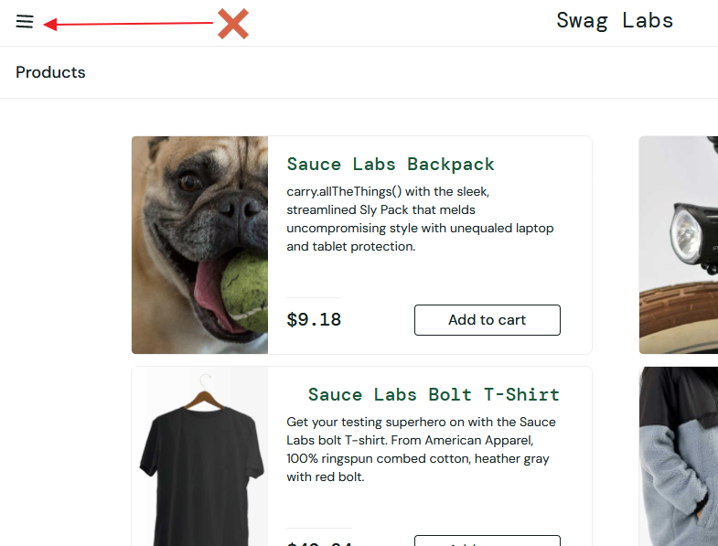
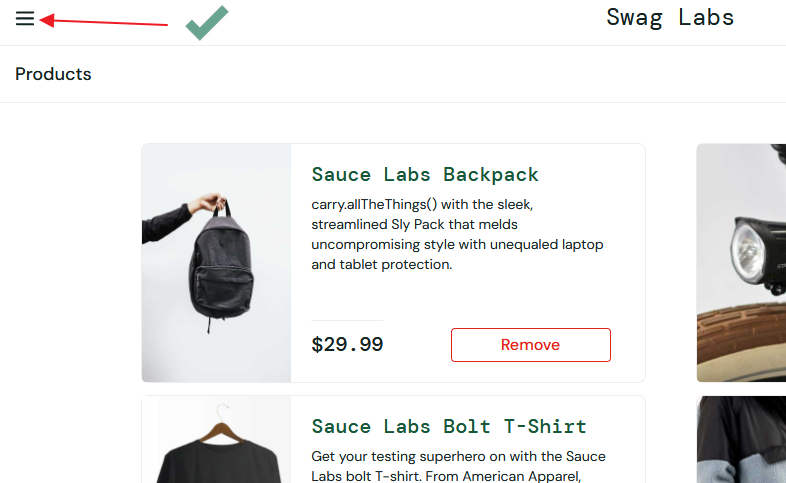

# BUG-09
## Summary:
The hamburger menu icon is incorrect.
## Related Test Case:
TC-34
## Environment:
Win 10 Pro 19045.6466 + Chrome 152.0.7977.83 (Official Build) (64-bitowa)
## Preconditions:
The user is logged in as visual_user.
## Test Data:
- Username: visual_user
- Password: secret_sauce
## Steps to Reproduce:
1. Open https://www.saucedemo.com/ 
2. Enter the correct username and password 
3. Click the "Login" buton
## Actual Result:
The hamburger menu icon is incorrect.
## Expected Result:
The correct hamburger menu icon should be displayed.
## Priority:
Low
## Attachments:

