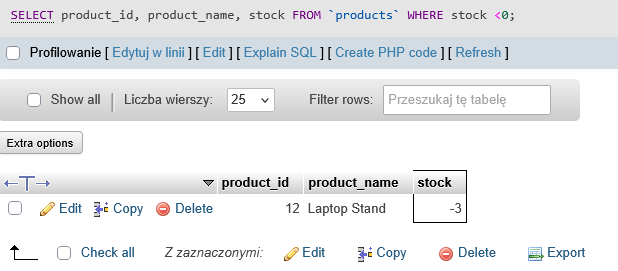

# BUG-01
## Summary:
Product has negative stock.
## Related Test Case:
TC-04
## Environment:
XAMPP v3.3.0 + 10.4.32-MariaDB + phpMyAdmin
## Preconditions:
Database qa_sql_portfolio exists and test data is loaded.
## SQL:
SELECT product_id, product_name, stock FROM `products` WHERE stock <0;
## Steps to Reproduce:
1. Open phpMyAdmin
2. Select "products" database
3. Open SQL
4. Enter the SQL code
5. Verify that no product has zero or negative stock
## Actual Result:
One of the products has negative stock.
## Expected Result:
No product should have zero or negative stock.
## Priority: 
High
## Attachments:

