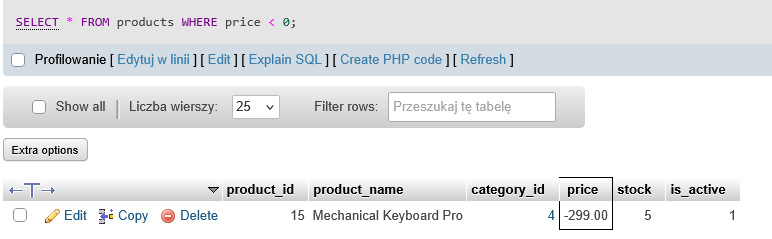

# BUG-02
## Summary:
Product has negative price.
## Related Test Case:
TC-17
## Environment:
XAMPP v3.3.0 + 10.4.32-MariaDB + phpMyAdmin
## Preconditions:
Database qa_sql_portfolio exists and test data is loaded.
## SQL:
SELECT * FROM products WHERE price < 0;
## Steps to Reproduce:
1. Open phpMyAdmin
2. Select "products" database
3. Open SQL
4. Enter the SQL code
5. Verify the prices of products
## Actual Result:
Mechanical Keyboard Pro has negative price of -299.00.
## Expected Result:
No products with a negative price should be returned.
## Priority: 
Medium
## Attachments:

