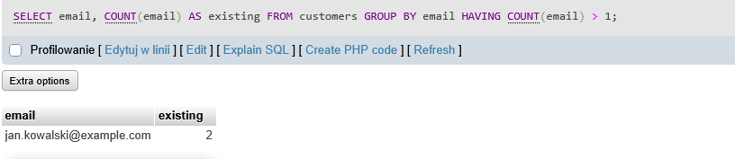

# BUG-03
## Summary:
Email addresses is duplicated.
## Related Test Case:
TC-18
## Environment:
XAMPP v3.3.0 + 10.4.32-MariaDB + phpMyAdmin
## Preconditions:
Database qa_sql_portfolio exists and test data is loaded.
## SQL:
SELECT email, COUNT(email) AS existing FROM customers GROUP BY email HAVING COUNT(email) > 1;
## Steps to Reproduce:
1. Open phpMyAdmin
2. Select "customers" database
3. Open SQL
4. Enter the SQL code
5. Verify the emails
## Actual Result:
One of the email addresses is duplicated.
## Expected Result:
No duplicate email groups should be returned.
## Priority: 
High
## Attachments:

