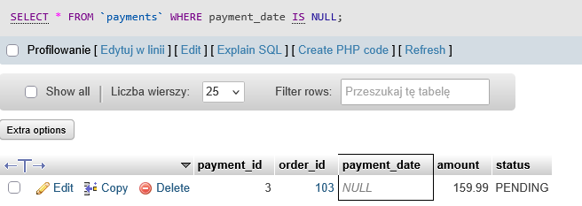

# BUG-04
## Summary:
The payment date is empty.
## Related Test Case:
TC-19
## Environment:
XAMPP v3.3.0 + 10.4.32-MariaDB + phpMyAdmin
## Preconditions:
Database qa_sql_portfolio exists and test data is loaded.
## SQL:
SELECT * FROM `payments` WHERE payment_date IS NULL; 
## Steps to Reproduce:
1. Open phpMyAdmin
2. Select "payments" database
3. Open SQL
4. Enter the SQL code
5. Verify the payment dates
## Actual Result:
The payment date for one of the payments is empty.
## Expected Result:
No records should be returned. Any returned record indicates a payment with a missing payment date.
## Priority: 
Medium
## Attachments:

