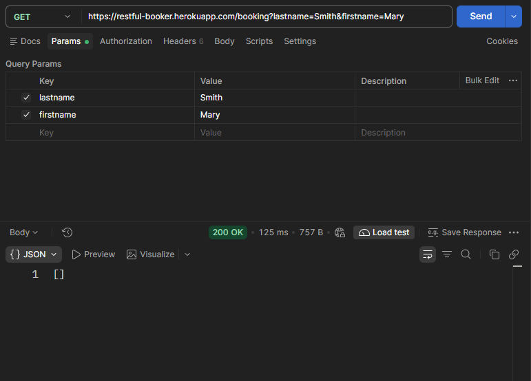

# BUG-01
## Summary:
Booking IDs are not displayed.
## Related Test Case:
TC-07
## Environment:
Win 10 Pro 19045.6466 + Postman 12.33.1 + QA – Restful Booker Demo API
## Preconditions:
A booking with the specified first and last name exists.
## Test data:
- Firstname: Mary
- Lastname: Smith
## Steps to Reproduce:
1. Open postman
2. Send GET / https://restful-booker.herokuapp.com/booking?lastname=Smith&firstname=Mary
3. Verify status code and response body
## Actual Result:
The response status code is 200, and no booking IDs associated with the non-existent first name are displayed.
## Expected Result:
The response status code should be 200, and booking IDs associated with the non-existent first name should not be displayed.
## Priority: 
High
## Attachments:

